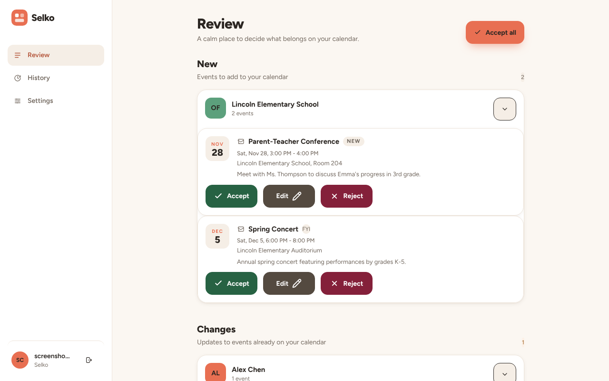
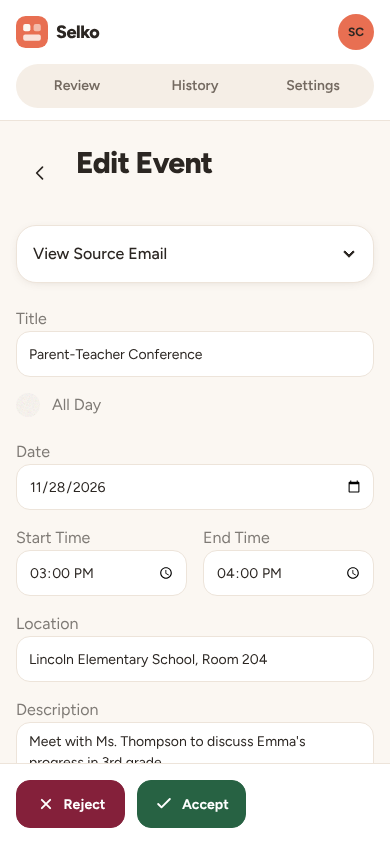
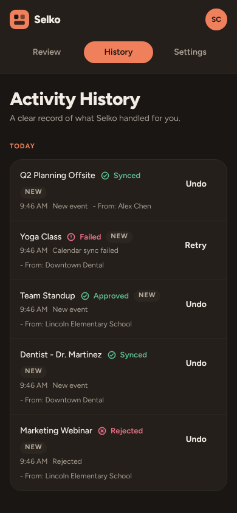
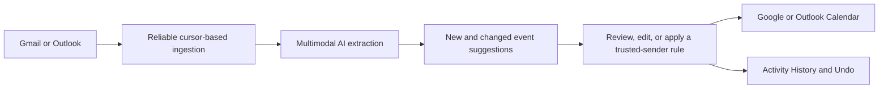

# Selko

### Your inbox already knows what is happening. Selko turns it into a calendar you can trust.

School reminders, appointments, reservations, community events, tickets, and
schedule changes arrive scattered across email threads and attachments. Selko
reads that information, understands the details, and turns it into clear
calendar suggestions—without asking you to copy dates, decipher PDFs, or hunt
through your inbox again.

**Selko is live in production on the web**, its only client.

## From email overload to a calm review queue

Selko connects to Gmail or Outlook, extracts the events that matter, and shows
you exactly what it found. You can edit, approve, or reject each suggestion
before it reaches Google Calendar. Trusted-sender rules are opt-in for the
things you genuinely want automated.

It also recognizes updates to events you already have. Instead of creating a
duplicate, Selko presents the proposed changes and lets you review the
before-and-after details.

<table>
  <tr>
    <td width="58%" align="center">
      <a href="docs/screenshots/web-review-queue-desktop-light.png">
        
      </a>
      <br><sub>Web review queue</sub>
    </td>
    <td width="21%" align="center">
      <a href="docs/screenshots/web-event-detail-mobile-light.png">
        
      </a>
      <br><sub>Event review on a phone</sub>
    </td>
    <td width="21%" align="center">
      <a href="docs/screenshots/web-history-mobile-dark.png">
        
      </a>
      <br><sub>Activity history on a phone</sub>
    </td>
  </tr>
</table>

## What Selko does

- **Understands real email** — reads Gmail and Outlook messages plus PDFs,
  images, and other supported attachments.
- **Finds the useful details** — resolves dates, times, time zones, locations,
  all-day events, and recurrence from natural language.
- **Creates suggestions, not surprises** — new events enter a human review
  queue by default.
- **Handles changes intelligently** — matches related calendar events and
  presents field-level updates instead of creating duplicates.
- **Syncs safely with Google Calendar** — approved events are inserted or
  updated idempotently.
- **Keeps an activity record** — History shows what happened, exposes failed
  syncs, supports retry, and lets you undo changes.
- **Learns your explicit preferences** — ignore noisy senders or opt trusted
  senders into automatic approval.
- **Works wherever you are** — a responsive web app for desktop and phone.

## Designed around control

Selko's goal is not maximum automation. It is dependable assistance.

- Your inbox is read through provider OAuth.
- OAuth tokens stay server-side.
- Per-user Row-Level Security protects application data.
- Calendar writes are traceable and recoverable.
- Existing Google Calendar changes are compared before undo; if something
  differs, Selko shows the exact conflict before offering Force Undo.
- Extraction quality is measured against a curated regression eval suite, and
  production parsing failures become new eval cases.

## How it works



Selko's LLM gateway supports several providers, chosen by evals. Production runs
one model, Anthropic `claude-haiku-5-5`, with no fallback provider, so the
privacy policy names exactly one AI provider
([ADR 0009](docs/adr/0009-llm-centric-extraction-one-model.md)).

## Product status

The end-to-end Email → Review → Calendar journey (Google Calendar or Outlook
Calendar) is in production at `https://api.selkoapp.com`, with automatic
catch-up after an OAuth reconnection and live updates over the `/live` stream.
What Selko does today is in [docs/requirements/](docs/requirements/); open work
is tracked in GitHub issues.

## Architecture

One process serves the web app, the API and the background workers on one
port, over one SQLite file. All state lives in a data directory
(`SELKO_DATA_DIR`): `selko.db` and the stored attachments. The web app talks
only to the API; the API signs users in itself. Database rows are also the
durable work queues: workers claim them with fenced leases and bounded retries,
and a committed write wakes the worker that should act on it.

```text
Browser ── one origin ──→ selko (uvicorn, one process)
                            ├── web app (built SvelteKit, static)
                            ├── API: sign-in, data, /live updates
                            └── workers: mail polling, LLM extraction,
                                calendar writes
                                    │
                                    └── /data: selko.db + attachments/
```

It ships as one signed container image, `ghcr.io/tonimelisma/selko:<sha>`,
built and checked by `.github/workflows/image.yml`.

### Stack

- **Web:** SvelteKit 2, Svelte 5, DaisyUI
- **Backend:** Python, FastAPI, Pydantic
- **Data:** SQLite (WAL, one writer), files on disk
- **AI:** multimodal, multi-provider LLM gateway; production runs one Anthropic model
- **Tooling:** `uv`, npm, Docker (the image)

See [docs/architecture.md](docs/architecture.md) for the architecture and [docs/index.md](docs/index.md) for every doc.

## Local development

### Prerequisites

- Python 3.14+
- [uv](https://github.com/astral-sh/uv)
- Node.js ≥ 22.12 for the web client
- Docker, only to build and check the image

### Setup

```bash
git clone https://github.com/tonimelisma/selko.git
cd selko
uv sync
cp .env.example .env     # set SELKO_JWT_SECRET: openssl rand -hex 32
```

Run the backend (it creates and migrates `data/selko.db` on start):

```bash
uv run uvicorn selko.api.app:app --port 8000
```

Run the web client:

```bash
cd frontend
npm install
npm run dev
```

Or run it all as production does:

```bash
./scripts/build-image.sh selko:dev
docker run --read-only --tmpfs /tmp --cap-drop ALL --security-opt no-new-privileges \
  --memory 400m -v selko-data:/data -p 8000:8000 \
  -e SELKO_JWT_SECRET="$(openssl rand -hex 32)" -e ALLOWED_ORIGINS=http://localhost:8000 \
  selko:dev
```

## Testing

```bash
# Backend (unit + integration; no service needed)
./scripts/verify.sh backend

# The image under the server's limits
./scripts/image-lane.sh

# Frontend
cd frontend
npm run test:unit
npm run check
```

Platform-specific commands and required visual verification are documented in
[CLAUDE.md](CLAUDE.md) and [docs/design/testing.md](docs/design/testing.md).

## Documentation

| Document | Purpose |
|---|---|
| [docs/index.md](docs/index.md) | Map of every doc |
| [docs/requirements/](docs/requirements/) | What Selko does today, with the tests that prove it |
| [docs/architecture.md](docs/architecture.md) | How it is built, and why |
| [docs/adr/](docs/adr/) | Decisions |
| [docs/design/database-schema.md](docs/design/database-schema.md) | Database reference |
| [docs/design/client-api.md](docs/design/client-api.md) | The API the web app uses |
| [docs/design/workers.md](docs/design/workers.md) | Background-worker architecture |
| [docs/design/llm.md](docs/design/llm.md) | Model routing and extraction |
| [docs/design/evals.md](docs/design/evals.md) | Regression eval workflow |

## License

Proprietary, commercially copyrighted software. Copyright © 2026 Toni Melisma.
All rights reserved.
